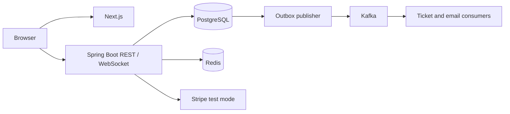

# Architecture and implementation boundaries

The backend is a modular monolith organized by feature; the frontend is a separate
Next.js app. Current implementation: HTTP/security foundation only. The diagram
below describes the intended system, not completed integrations.

## Resolve these specification details during implementation

- PostgreSQL partial indexes cannot depend on a joined booking's status. Store
  an `active` flag on booking-seat allocations, update it in the same transaction
  as the booking, and use a partial unique index on `seat_id WHERE active`.
- A Stripe Checkout Session has a longer minimum expiry than a ten-minute hold.
  Do not simply set its expiry to the hold deadline. Coordinate expiry, payment
  completion, seat ownership, and late-payment refunds explicitly; check the
  current Stripe contract when implementing payments.
- Distributed locks must remain held through database commit. Call a separate
  transactional service inside the lock scope, then release locks after that
  service returns. A fixed lease can expire during a slow transaction; database
  allocation uniqueness and optimistic versions remain mandatory safety nets.
- Outbox publication is at least once. A crash after Kafka acknowledges but before
  `published_at` is committed can redeliver; consumers must deduplicate durably.
- Email consumers cannot assume a second consumer group has already made tickets.
  Send notifications from a durable `TicketsIssued` event or retry until ready.

These are future design requirements, not guarantees provided by this skeleton.
